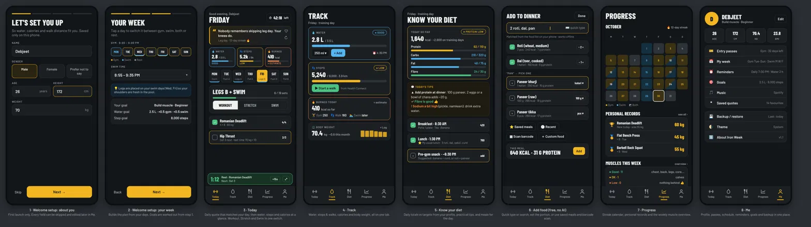
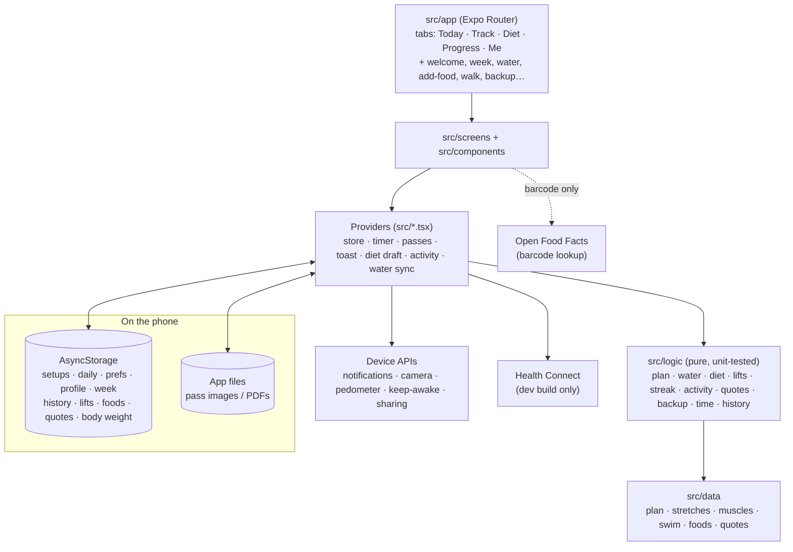

# Iron Week

A personal gym + swim planner for Android (and iOS), built with **Expo SDK 58**, React Native and TypeScript.
No account, no backend, no database: **everything stays on the phone**.


*Design mockups (`docs/design/`). The app follows them; real screenshots can replace these later.*

## Features

**Today**
- Greeting, today's day and a **session timer chip** (tap to start/pause, long-press for reset and quick 60s / 90s / 2m rests).
- **Daily quote**: 361 quotes (original lines + public-domain Seneca, Marcus Aurelius, Epictetus, Lao Tzu, Confucius),
  picked from the date and your context (leg day, swim, streak, missed day, new PR). ♡ save, ↻ another.
- **Water / Steps / Burned** chips. **Gym mode** shrinks them and the quote into one slim line while you train.
- Day tabs Mon–Sun and a **Workout / Stretch / Swim** switch:
  - Collapsible exercise cards: sets 1–6, reps per set, **kg per set** (0.5 kg steps, "BW +kg" for bodyweight),
    "Last time: 40 kg × 10", a **progression hint** (+2.5 kg, +5 kg or +1 rep), **🏆 New PR** on the set,
    body diagram, form steps, demo / image links, **⇄ Swap** for a busy machine, finisher, auto-open next card.
  - Full-body warm-up and cool-down that change daily, with a guided routine.
  - Swim card with 4 timed blocks and a guided swim timer.
- **Timers**: rest timer on every ticked set, full-screen big timer (+15s, Skip, Stop, Minimize) reachable from every tab,
  green **mini timer bar** above the tabs, "💧 Sip water" every 15 min during a session. Each step also schedules a
  notification, so alerts arrive with the phone locked.
- **Light week** every 7th week, **Finish workout** summary (time, sets, volume, PRs, muscles, ≈ kcal),
  Muscles worked and the Weekly overview.

**Track**
- **Water**: goal 3.0 L (+0.5 L gym, +0.5 L swim), five status bands, a speed warning above 1 L/hour, amount dropdown,
  undo, details with ring + 7-day chart, and smart reminders (only when you forget, never during gym/swim or quiet hours,
  with **+250 ml / +500 ml / Snooze** buttons).
- **Steps** from Health Connect (development build), goal 8,000, distance from your stride.
- **Walking zone**: time / steps / km / pace, goals, brisk mode (easy ↔ fast every 3 min).
- **Burned today**: MET × weight × time, or your watch's active calories when Health Connect has them.
- **Body weight** log with sparkline and change this month.

**Diet** (free, offline, no AI, no photos)
- 67 common Indian foods with Hindi names and real portions (roti, katori, glass…), values from IFCT 2017 / USDA (approximate).
- **Quick type** "2 roti, dal, paneer bhurji", fuzzy search, saved meals, recents, custom foods,
  **barcode scan** via Open Food Facts.
- Targets from Mifflin–St Jeor and your goal; protein / carbs / fat / fibre bars; friendly "what to add" tips.
  *Guidance only, not medical advice.*

**Progress**: streak, month calendar (gym / swim / both), personal records with the previous best, muscles this week.

**Me**: profile + BMI, entry passes (PDF or photo, max brightness, expiry reminder), My week (days, times, workout order:
legs land on swim days), notifications + quiet hours, goals, music, saved quotes, **backup / restore**, theme, about.

## Run it

You need **Node.js 22 LTS or newer**. Then, in this folder:

```bash
npm install
```

### Option A: Expo Go (quickest, everything except daily steps)

```bash
npx expo start --go --tunnel
```

Scan the QR code from inside **Expo Go**. The terminal must say `Using Expo Go`.

### Option B: development build (needed for Health Connect steps)

Build once in the cloud (free Expo account, no Android Studio):

```bash
npx eas-cli@latest build -p android --profile development
```

Install the APK from the link EAS gives you, then:

```bash
npx expo start --dev-client --tunnel
```

and open the project from inside the installed **Iron Week** app.

> With `expo-dev-client` installed, a plain `npx expo start` targets the development build. Use `--go` for Expo Go.

## Build an installable APK

```bash
npx eas-cli@latest build -p android --profile preview
```

The `preview` profile builds a release APK for **arm64 only** (`reactNativeArchitectures=arm64-v8a`, which covers
current Android phones), with code minification and resource shrinking on (`expo-build-properties`). That keeps the
download small. The exact size is shown on the build page when it finishes. `production` builds an `.aab` for the Play Store.

## Architecture



- **`src/logic/`** holds the rules as pure functions (water bands, reminder timing, plan builder, targets, PRs, streak…).
  They have no React or device code, so they're tested with Jest.
- **`src/storage/`** owns the key names, the **schema version** and migrations; `src/backup.ts` exports / restores
  every key plus the pass files as one versioned JSON file.
- **Daily history** (≥ 365 days) is written when the day rolls over: sets, swim, stretch, water, steps, walks, kcal,
  diet totals, PRs. It powers the streak, calendar and charts.

To change the training plan, edit `src/data/` (exercises, sets, reps, rest, stretches). The rest of the app follows.

## Your data

- Everything is saved **only on this phone** (AsyncStorage + app files). There is no account and no server.
- Only two things use the internet: **looking up a scanned barcode** (Open Food Facts: only the barcode number is sent)
  and **converting a pass PDF** to an image once (pdf.js from a CDN).
- Health Connect is **read-only** (steps, active calories) and only after you allow it.
- **Me → Backup / restore** saves everything to one file you keep (Drive, WhatsApp…), and restores it on a new phone.

## Checks

```bash
npm run typecheck    # tsc --noEmit
npm run lint         # expo lint
npm test             # jest (jest-expo): 73 tests over the logic and storage
npx expo-doctor      # dependency and config check
```

## Roadmap

- Real screenshots / a short GIF in `docs/`.
- iOS steps through HealthKit.
- Home-screen widget for water and the next workout.
- Charts for lifts over time (per exercise).
- More foods, and per-food serving photos.
